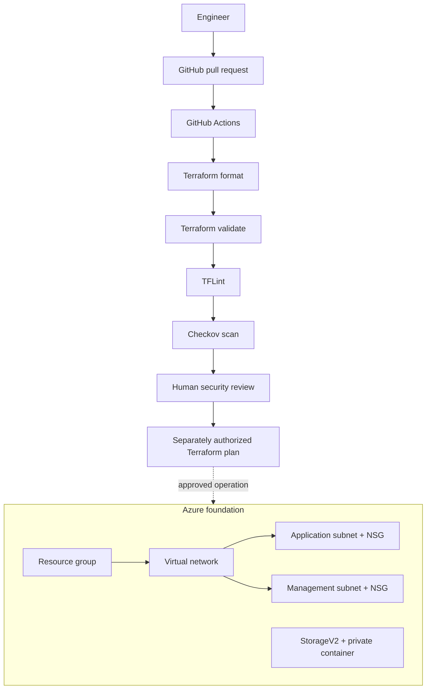

<div align="center">


### Secure infrastructure foundations · Policy checks · Network segmentation

[](https://azure.microsoft.com/)
[](https://developer.hashicorp.com/terraform)
[](https://github.com/terraform-linters/tflint)
[](https://www.checkov.io/)

**A modular Azure infrastructure lab that puts network boundaries and infrastructure security checks into the Terraform development lifecycle.**

[Architecture](#-architecture) · [Quick start](#-validate-the-foundation) · [Security posture](#-security-posture) · [Documentation](docs/README.md)

</div>

> [!NOTE]
> This repository is a Terraform reference foundation. It is not represented as a fully deployed production platform. Review the current CI run and the security findings before treating any control as validated.

## Why this project exists

Cloud infrastructure should be reviewed as application code: repeatable, linted, validated and scanned before deployment. This project focuses on reusable Azure network and storage foundations, with security findings made visible rather than silently ignored.

## Architecture



## Implemented foundation

| Component | Design intent |
|---|---|
| Terraform environment root | Environment-specific inputs and composition |
| Network module | VNet, application and management subnets |
| Application NSG | Sample inbound HTTPS rule scoped to the VNet service tag |
| Management NSG | No custom inbound allow rule; default inbound deny remains |
| Storage module | StorageV2 account and private blob container |
| CI | Formatting, backend-free initialization, validation, TFLint and Checkov |

## Security posture — read before applying

- Application subnet sample rule permits TCP/443 from the VNet service tag; it is **not** an Internet-facing ingress design.
- Management subnet has no custom inbound allow rule. Use an approved VPN, Bastion or private management path before enabling access.
- The current storage example still enables Storage account public network access and shared-key authentication. These are documented as demo trade-offs, **not** a hardened production baseline.
- Before storing real data, design private endpoint connectivity and Microsoft Entra data-plane authorization. Validate provider authentication requirements before disabling shared keys.
- Checkov currently runs in advisory mode while customer-managed key integration and Blob read diagnostics remain open. See [Checkov findings and exceptions](docs/checkov-findings-and-exceptions.md).

## Validate the foundation

Use the development root module:

```bash
terraform -chdir=environments/dev fmt -check -recursive
terraform -chdir=environments/dev init -backend=false
terraform -chdir=environments/dev validate
tflint --recursive
```

Run Checkov against the infrastructure directory:

```bash
checkov -d . --framework terraform
```

Check the actual repository workflow for the authoritative working directory and current CI commands. A successful static check does not prove that Azure deployment or runtime connectivity works.

## Repository map

```text
.github/workflows/       CI quality and security checks
environments/dev/        Development Terraform root
modules/network/         VNet, subnets and NSGs
modules/storage/         Storage account and private container
docs/                    Security findings and engineering guides
.tflint.hcl              TFLint configuration
```

## Engineering decisions

1. Keep network zones explicit rather than relying on a flat VNet.
2. Separate application and management access policies.
3. Run static checks without cloud credentials where possible.
4. Treat scanner findings as engineering work items with owners and closure evidence.
5. Require a reviewed Terraform plan and a separately authorized deployment step.

## Roadmap

- [ ] Close or formally accept the documented storage security findings.
- [ ] Add private endpoint and private DNS design for storage.
- [ ] Introduce narrowly scoped identity-based data-plane access.
- [ ] Add diagnostics and centralized monitoring.
- [ ] Validate the design in a disposable Azure subscription.
- [ ] Capture genuine deployment and CI evidence.

## Documentation

- [Security findings and exceptions](docs/checkov-findings-and-exceptions.md)
- [Architecture and interview guide](docs/README.md)
- [Zero-to-hero implementation guide](docs/ZERO-TO-HERO.md)
- [Advanced interview scenarios](docs/ADVANCED-INTERVIEW-BANK.md)

## Maintainer

**MD Amirul Haque** · [GitHub](https://github.com/haqueamir70-coder) · [LinkedIn](https://www.linkedin.com/in/md-amirul-haque/)

<sub>Secure defaults are a design decision, not a badge.</sub>
