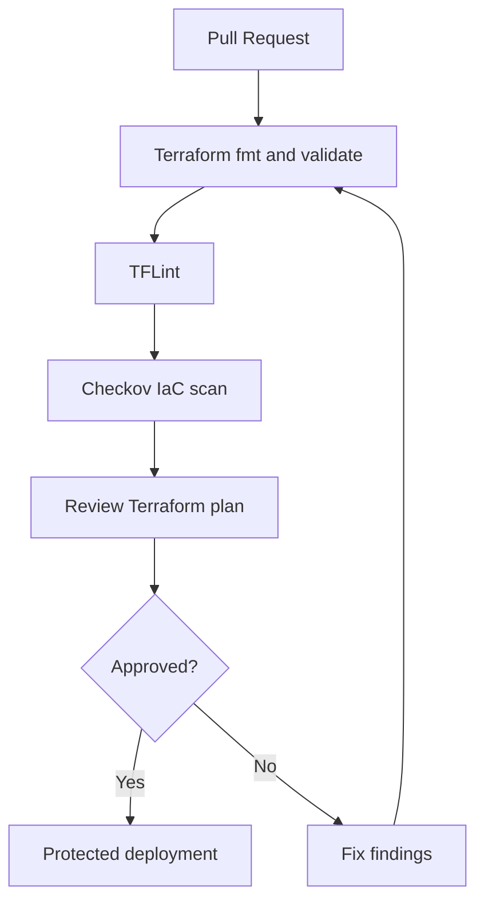

<div align="center">


[](https://developer.hashicorp.com/terraform)
[](https://azure.microsoft.com/)
[](https://github.com/haqueamir70-coder)

</div>

> **Portfolio project:** implementation status and limitations are documented below. The diagram describes the intended workflow/architecture and is not proof of a successful production deployment.

## 🗺️ Architecture at a Glance



---

# Azure DevSecOps Platform

A Terraform-focused portfolio project for exploring modular Azure infrastructure, environment separation, and security checks as part of an Infrastructure as Code workflow.

## Repository layout

- `.github/` — GitHub Actions workflow configuration
- `environments/dev/` — development root module and environment inputs
- `modules/network/` — virtual network, app/management subnets, and separate NSGs
- `modules/storage/` — StorageV2 account and private blob container
- `.tflint.hcl` — TFLint configuration

## Network security model

The app subnet and management subnet now use separate network security groups:

- **Application NSG:** allows inbound TCP/443 from any source. This is a broad internet-facing rule; in a real deployment, scope the source to the intended ingress path (for example, an approved load balancer, application gateway, or trusted CIDRs).
- **Management NSG:** has no custom inbound allow rules, so the default inbound deny applies. Add narrowly scoped access only after defining a trusted management path such as VPN, Bastion, or a private jump host.
- NSG rules alone do not create a complete security boundary. Review outbound flows, routing, private endpoints, diagnostics, and the actual workload exposure.

## Storage security and naming

- The blob container is private, HTTPS-only is enabled, and minimum TLS is set to TLS 1.2.
- The current example still enables public network access to the Storage account and shared-key authentication. Treat these as explicit demo trade-offs, not a hardened production baseline. Before using real data, design private endpoint/network access and Microsoft Entra ID data-plane authorization; validate the Terraform provider's authentication requirements before disabling shared keys.
- Set `storage_account_name` through an environment input. Azure Storage account names are globally unique and must be 3–24 lowercase letters/numbers; do not rely on a shared example name.

## CI and local validation

The workflow under `.github/workflows/` defines format, initialization without a backend, validation, TFLint, and Checkov steps. This documentation does **not** claim those checks have passed; inspect the latest GitHub Actions run for evidence.

From the relevant root module, after setting required inputs:

```bash
terraform fmt -check -recursive
terraform init -backend=false
terraform validate
tflint --recursive
```

The configured backend and Azure identity must be set up before running plans that use remote state. Do not apply infrastructure until the plan and security findings have been reviewed.

## Security principles

- Prefer workload identity federation/OIDC for GitHub Actions to Azure where supported.
- Grant only the Azure permissions required by the pipeline.
- Secure remote state with access controls and locking.
- Never commit credentials, state files, real `*.tfvars`, or sensitive plan artifacts.
- Pin and review GitHub Actions and provider versions.
- Require human review and protected-environment approval before production applies.
- Add logging, diagnostics, policy checks, and a documented rollback/cleanup process.

## Author

MD Amirul Haque · [GitHub profile](https://github.com/haqueamir70-coder) · [LinkedIn](https://www.linkedin.com/in/md-amirul-haque/)
