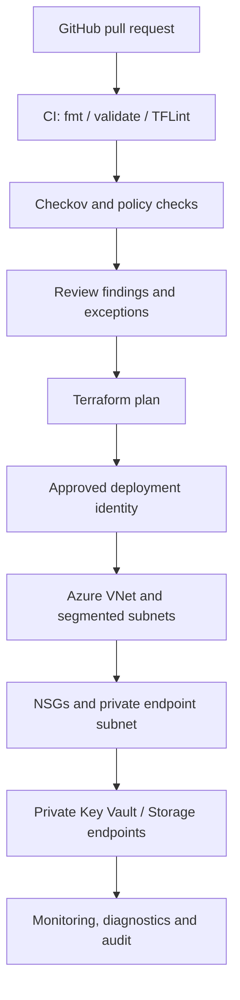

# Azure DevSecOps platform — Architecture & Interview Guide

The diagram shows the intended modular Terraform and security-control flow. Public access, private endpoints and diagnostics must be verified against the current module configuration and target Azure policies.

## Architecture diagram

## Interview questions

1. 1. What security controls should a reusable Azure Terraform module enforce by default?
2. 2. How do you design private endpoint subnet policies and NSG associations?
3. 3. What is the difference between service endpoints and private endpoints?
4. 4. How do you implement Azure RBAC for Key Vault without access policies?
5. 5. Why disable Storage public network access and Shared Key authorization?
6. 6. How do Checkov and TFLint complement terraform validate?
7. 7. How should security exceptions be documented and time-bounded?
8. 8. What is the difference between advisory and blocking security scans?
9. 9. How would you add customer-managed keys and diagnostic settings?
10. 10. How do you prove that a deployment meets the intended security posture?

## Interview preparation note
Be ready to explain the design decision, security boundary, failure mode, operational signal and validation evidence for each answer. Clearly separate implemented code, CI-validated configuration, cloud-deployed resources and future roadmap items.
