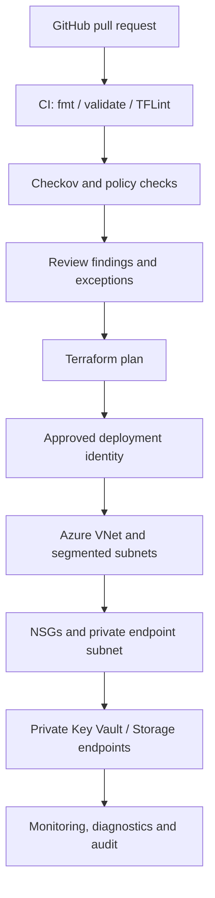

# Azure DevSecOps platform — Architecture & Interview Guide

The diagram shows the intended modular Terraform and security-control flow. Public access, private endpoints and diagnostics must be verified against the current module configuration and target Azure policies.

## Architecture diagram

## Interview questions

1. 1. What security controls should a reusable Azure Terraform module enforce by default?
2. 2. How do you design private endpoint subnet policies and NSG associations?
3. 3. What is the difference between service endpoints and private endpoints?
4. 4. How do you implement Azure RBAC for Key Vault without access policies?
5. 5. Why disable Storage public network access and Shared Key authorization?
6. 6. How do Checkov and TFLint complement terraform validate?
7. 7. How should security exceptions be documented and time-bounded?
8. 8. What is the difference between advisory and blocking security scans?
9. 9. How would you add customer-managed keys and diagnostic settings?
10. 10. How do you prove that a deployment meets the intended security posture?

## Interview preparation note
Be ready to explain the design decision, security boundary, failure mode, operational signal and validation evidence for each answer. Clearly separate implemented code, CI-validated configuration, cloud-deployed resources and future roadmap items.

## Interview questions — suggested answers

### 1. Answer

Reusable modules should default to least privilege, private networking where appropriate, TLS, encryption, diagnostics, secure identity and explicit input validation. Defaults must be configurable without weakening safety silently.

### 2. Answer

Place private endpoints in a dedicated subnet, enable required network policies, associate an NSG, and permit only required source/destination flows. Validate DNS and routing from consumer subnets.

### 3. Answer

Service endpoints keep traffic on Azure backbone but target the public service endpoint; private endpoints assign a private IP in your VNet and provide private connectivity to the service.

### 4. Answer

Use Azure RBAC roles scoped to the vault or individual resources, assign identities rather than users where possible, and avoid broad subscription-level data access.

### 5. Answer

Disabling public access reduces the reachable attack surface; disabling Shared Key favors identity-based authorization. Verify clients support Entra authentication before enforcing.

### 6. Answer

terraform validate checks configuration correctness, TFLint adds Terraform/provider-specific linting, and Checkov checks known IaC security policies. Their coverage overlaps but is not identical.

### 7. Answer

Record the control, rationale, owner, compensating measure, expiry and remediation issue. Exceptions should be approved, time-bounded and re-evaluated in CI.

### 8. Answer

Advisory scans report findings without failing the pipeline; blocking scans return non-zero for policy violations. Move to blocking after baselining and triaging existing findings.

### 9. Answer

Add Key Vault/Storage CMK integration with managed identity and diagnostic settings routed to a protected Log Analytics workspace, then test key rotation and failure behavior.

### 10. Answer

Use Terraform plan/apply evidence, Azure resource configuration queries, private DNS resolution tests, network connectivity tests and diagnostic logs. Static validation alone is insufficient.

## Complete zero-to-hero guide

See [ZERO-TO-HERO.md](./ZERO-TO-HERO.md) for the business scenario, architecture walkthrough, tool-by-tool explanations, implementation sequence, practical commands, troubleshooting playbook and additional scenario-based interview questions with answers.
