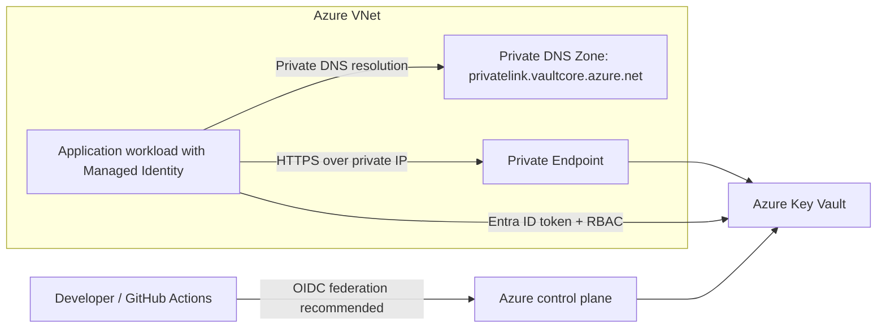

# Azure Key Vault — Private Secrets Management with Terraform

> Portfolio lab demonstrating Azure Key Vault security controls. This is an example architecture, not a claim of a deployed or production-validated environment.

## What this project demonstrates

- Azure Key Vault with Azure RBAC authorization
- Public network access disabled
- Private Endpoint + Private DNS Zone for private name resolution
- Soft delete and purge protection
- Diagnostic settings design notes
- Terraform validation and Checkov scanning in GitHub Actions
- Draw.io architecture source in [docs/azure-key-vault-architecture.drawio](docs/azure-key-vault-architecture.drawio)

## Architecture



## Repository structure

- `main.tf` — VNet, subnet, Key Vault, Private DNS, Private Endpoint, role assignment
- `variables.tf` — configurable inputs; no secrets
- `outputs.tf` — non-sensitive resource metadata
- `versions.tf` — Terraform/provider constraints
- `.github/workflows/terraform-checks.yml` — fmt, validate, Checkov
- `docs/azure-key-vault-architecture.drawio` — editable diagram source

## Prerequisites

- Terraform 1.6+
- Azure CLI logged in to the intended subscription
- Permissions to create a resource group, VNet/subnet, Key Vault, private endpoint, private DNS zone/link, and role assignment
- A workload identity / service principal object ID to receive the Key Vault Secrets User role (or leave it empty and manage role assignment separately)

## Deploy

1. Review all values and cost implications.
2. Authenticate to Azure and select the intended subscription:
   ```bash
   az login
   az account set --subscription "<SUBSCRIPTION_ID>"
   az account show --output table
   ```
3. Create a local `terraform.tfvars` (never commit it):
   ```hcl
   location                    = "eastus"
   resource_group_name         = "rg-kv-private-lab"
   name_prefix                 = "kv-lab-unique"
   workload_principal_object_id = ""
   ```
   The Key Vault name must be globally unique, 3–24 characters, alphanumeric/hyphen only, start with a letter, and end with a letter or digit. Adjust `name_prefix` to satisfy this.
4. Run:
   ```bash
   terraform fmt -check -recursive
   terraform init
   terraform validate
   terraform plan
   ```
5. Inspect the plan and security scan results before applying:
   ```bash
   terraform apply
   ```
6. When finished, remove lab resources with `terraform destroy` after checking the plan.

## Important networking note

With public network access disabled, a client must have network connectivity to the private endpoint and resolve the vault hostname to its private IP. A developer laptop outside the VNet cannot access the data plane merely because they have RBAC. Use a connected VNet, VPN/ExpressRoute, or a test VM inside the network, and validate DNS from that client.

## Security notes

- Do not store actual secrets in Terraform configuration or commit secret values.
- Terraform state can contain sensitive resource attributes. Use a secured remote backend, restrict access, enable state protection/versioning where supported, and never commit state files.
- Use GitHub Actions OIDC/workload identity federation instead of long-lived client secrets.
- Grant least privilege. `Key Vault Secrets User` is assigned only when `workload_principal_object_id` is supplied.
- Purge protection is enabled and cannot be disabled after creation; plan cleanup and naming accordingly.
- Diagnostic settings are environment-specific and should route audit logs to a protected Log Analytics workspace or other approved destination before production use.
- The included GitHub workflow runs static checks only; it does not authenticate or deploy to Azure.

## Troubleshooting checklist

1. **403 Forbidden:** confirm the caller's Entra ID identity and RBAC role assignment; allow for RBAC propagation.
2. **Timeout / cannot connect:** check private endpoint connection state, NSG/UDR/firewall paths, and client VNet connectivity.
3. **Wrong DNS answer:** from the workload network, resolve `<vault-name>.vault.azure.net`; it should ultimately resolve through `privatelink.vaultcore.azure.net` to the private endpoint IP.
4. **Terraform role assignment failure:** verify the identity object ID and that the Terraform deployment identity can create role assignments.
5. **Name unavailable:** Key Vault names are globally unique; choose another valid prefix.

## Interview topics covered

- Secrets vs keys vs certificates
- Azure RBAC vs legacy access policies
- Managed Identity and workload identity federation
- Private Endpoint vs Service Endpoint
- Private DNS resolution path
- Soft delete vs purge protection
- Terraform state security and secret leakage risks
- 403 vs network timeout troubleshooting

## Author

MD Amirul Haque · [GitHub profile](https://github.com/haqueamir70-coder) · [LinkedIn](https://www.linkedin.com/in/md-amirul-haque/)
